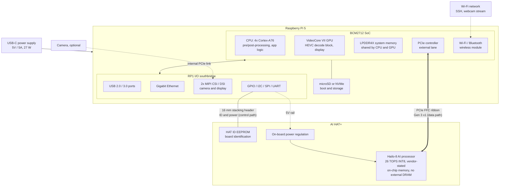
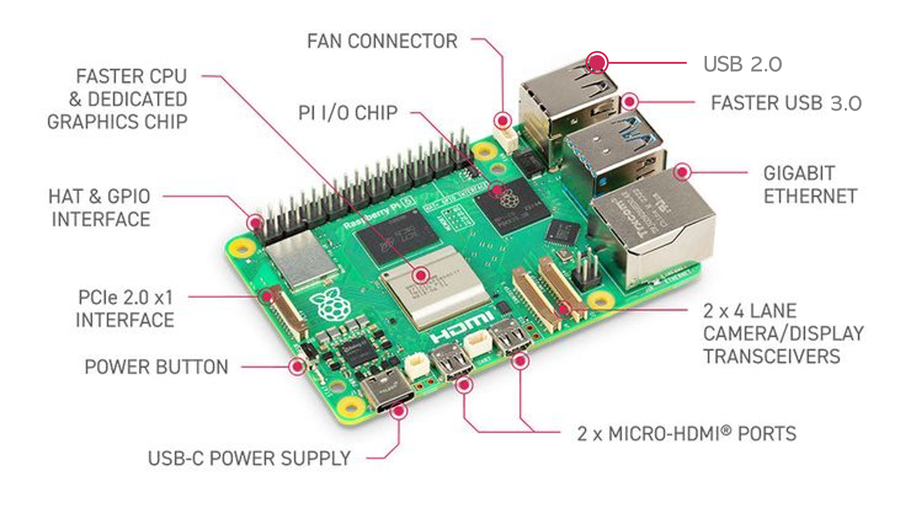
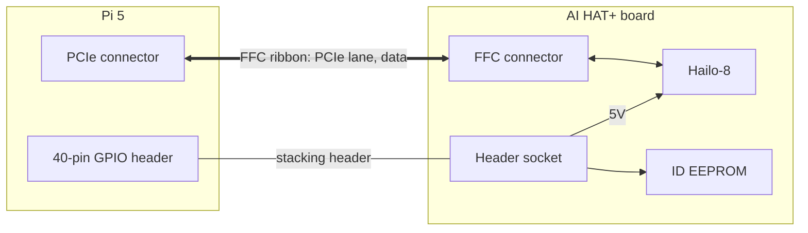
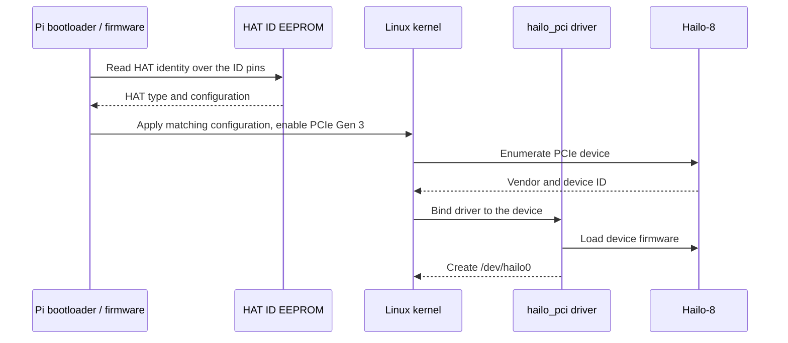
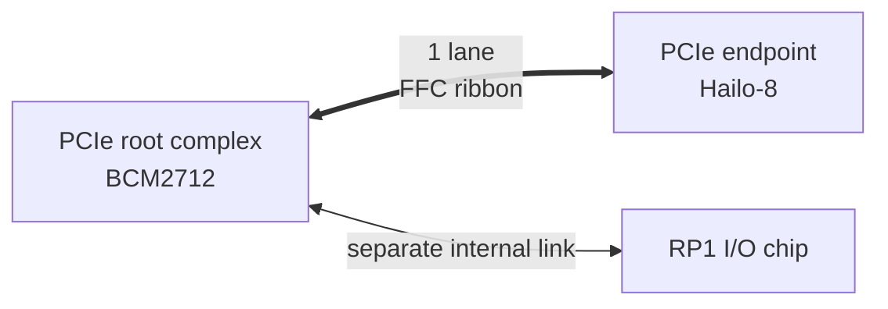
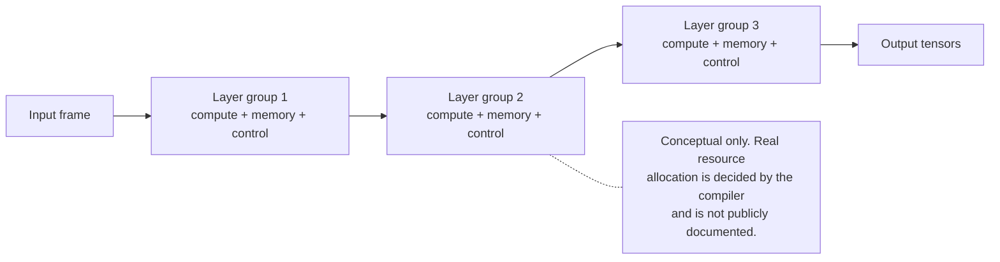
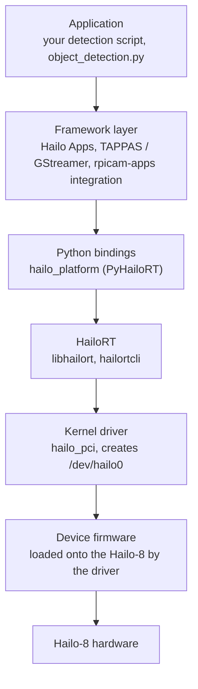
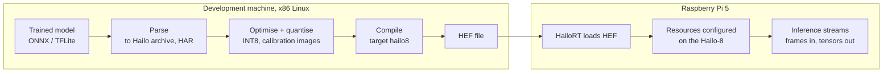
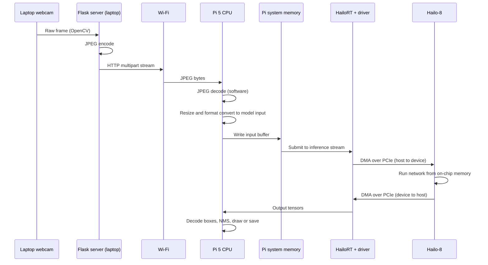

# Architecture: Raspberry Pi 5 + AI HAT+ (Hailo-8)

Detailed architecture reference for the platform documented in [README.md](README.md). It explains how the hardware is organised, how data moves between the Pi and the accelerator, how the software stack maps onto the hardware, and where performance and failures come from.

> **Confidence notes.** Pi 5 details are from Raspberry Pi's public documentation and general knowledge of the board. Hailo-8 details are limited to what Hailo publishes. Hailo does not document the chip's low-level internals (block counts, SRAM layout, interconnect), so those are not claimed here.

## Contents

1. [System overview](#1-system-overview)
2. [Raspberry Pi 5 architecture](#2-raspberry-pi-5-architecture)
3. [AI HAT+ architecture](#3-ai-hat-architecture)
4. [The PCIe link](#4-the-pcie-link)
5. [Hailo-8 architecture](#5-hailo-8-architecture)
6. [Software stack](#6-software-stack)
7. [Model lifecycle: from ONNX to HEF to inference](#7-model-lifecycle-from-onnx-to-hef-to-inference)
8. [End-to-end data path](#8-end-to-end-data-path)
9. [Power and thermal](#9-power-and-thermal)
10. [Performance model and bottlenecks](#10-performance-model-and-bottlenecks)
11. [Mapping the architecture to bringup checks](#11-mapping-the-architecture-to-bringup-checks)
12. [Sources and further reading](#12-sources-and-further-reading)

## 1. System overview

The platform is a host-plus-coprocessor design. The Raspberry Pi 5 is a general-purpose host that runs the OS and all application logic. The Hailo-8 is a fixed-function inference coprocessor that executes one compiled neural network at a time per resource allocation, and does nothing else.

**Two separate connections join the Pi and the HAT.** They do different jobs, which is useful when debugging:

| Connection | Physical | Carries | If it fails |
|---|---|---|---|
| PCIe FFC ribbon | Flat flexible cable, Pi PCIe connector to HAT | All inference data and device control traffic | No device in `lspci` |
| Stacking header | 16 mm 2x20 pin header on the GPIO | HAT identification (ID EEPROM) and power | HAT not auto-detected, Gen 3 not enabled, or no power |

---

## 2. Raspberry Pi 5 architecture

### 2.1 Key blocks

| Block | Detail | Role in this project |
|---|---|---|
| CPU | BCM2712, 4x Arm Cortex-A76, up to 2.4 GHz | Runs Linux, HailoRT, Python, video decode, resize, post-processing |
| GPU | VideoCore VII | Display output, HEVC hardware decode. Not used for the Hailo pipeline |
| System memory | LPDDR4X, shared between CPU and GPU (8 GB) | Holds frames, tensors, and buffers that are DMA'd to and from the Hailo-8 |
| External PCIe | One lane, officially Gen 2, Gen 3 available | Link to the Hailo-8 |
| RP1 southbridge | Separate I/O chip connected to the SoC over its own internal PCIe link | USB, Ethernet, camera, GPIO. Does not share the external PCIe lane with the HAT |
| Wi-Fi / Bluetooth | Wireless module attached to the SoC | SSH and the webcam stream |
| Boot storage | microSD or NVMe (`TODO`) | OS and model files |

### 2.2 Why the Pi side matters for AI work

- **The CPU does most of the pipeline.** Everything around the network (decode, resize, colour conversion, non-maximum suppression, drawing) runs on the four A76 cores.
- **Video decode is CPU-bound for most formats.** The Pi 5 has hardware HEVC decode but no hardware H.264 decode, and a Motion-JPEG stream (like the Flask webcam stream) is decoded in software by OpenCV. Expect high CPU use and heat at 720p.
- **Memory is shared.** Frames, intermediate buffers, and Hailo DMA buffers all live in the same LPDDR4X as the OS.
- **The HAT does not use RP1.** Heavy USB or Ethernet traffic does not contend with the PCIe lane to the Hailo-8 at the link level, though it still contends for CPU time and memory bandwidth.

---

## 3. AI HAT+ architecture

| Element | Detail |
|---|---|
| Accelerator | Hailo-8 (26 TOPS variant). The 13 TOPS AI HAT+ uses Hailo-8L instead |
| Mounting | Fits on the Pi 5 GPIO header via a 16 mm stacking header, held by spacers |
| Data connection | PCIe FFC ribbon to the Pi's PCIe connector |
| Identification | Onboard ID EEPROM read by the Pi at boot over the HAT ID pins on the header. This is how the Pi auto-detects the HAT and enables Gen 3, so no `config.txt` edit is needed |
| Power | Drawn from the Pi through the header (`TODO`: confirm against the AI HAT+ documentation) |

**Boot-time detection sequence**

---

## 4. The PCIe link

### 4.1 Topology

### 4.2 Bandwidth

| Link | Raw rate per lane | Encoding | Approx. usable, one direction |
|---|---|---|---|
| PCIe Gen 2 x1 | 5 GT/s | 8b/10b | about 0.5 GB/s |
| PCIe Gen 3 x1 (this platform) | 8 GT/s | 128b/130b | about 1 GB/s |
| PCIe Gen 3 x4 (Hailo-8 M.2 module maximum) | 8 GT/s | 128b/130b | about 4 GB/s |

Hailo-8 M.2 modules expose a x4 Gen 3 interface, but the Pi 5 provides a single lane, so this platform runs at roughly a quarter of the module's maximum link bandwidth. Real throughput is lower than the table once protocol overhead is counted.

### 4.3 Is the link a bottleneck?

Worked example for YOLOv8n at 640x640 input (8-bit RGB):

| Quantity | Value |
|---|---|
| Input frame size | 640 x 640 x 3 = 1,228,800 bytes, about 1.2 MB |
| At 30 FPS | about 37 MB/s host to device |
| At 100 FPS | about 123 MB/s host to device |
| Output tensors | Small compared with the input for detection models |
| Gen 3 x1 capacity | about 1,000 MB/s |

Even 100 FPS uses roughly an eighth of one direction of the link. For a single-stream detection model the link is not the limit. It becomes relevant for many simultaneous streams, much larger inputs, or models with large output tensors (for example dense segmentation masks).

---

## 5. Hailo-8 architecture

### 5.1 Specification summary

| Property | Value | Source type |
|---|---|---|
| Peak compute | 26 TOPS, INT8 | Vendor-stated |
| Typical power | about 2.5 W | Vendor-stated |
| Memory | On-chip, no external DRAM | Vendor-stated |
| Architecture | Structure-defined dataflow | Vendor-stated |
| Inference only | No training, no general FP32 path | Third-party analysis |
| Native interface | PCIe Gen 3, up to x4 on M.2 modules | Third-party report of the module |
| Variants | Hailo-8 (26 TOPS), Hailo-8L (13 TOPS), Hailo-8R (13 TOPS, mPCIe) | Vendor |

TOPS is a peak figure. No real network uses every resource on the chip, so measure FPS and latency for your model with `hailortcli benchmark`.

### 5.2 Dataflow vs. conventional execution

| | CPU / GPU style | Hailo structure-defined dataflow |
|---|---|---|
| Execution model | Instructions or kernels run against a shared memory | Network layers are mapped to dedicated resources connected by direct data paths |
| Where mapping happens | At run time | At compile time (Dataflow Compiler) |
| Memory | Large external DRAM, tensors move across a memory boundary | Distributed on-chip memory next to compute |
| Power | Much of the energy goes into data movement | Reduced data movement, low power |
| Flexibility | General, runs arbitrary code | Runs what the compiler can map |

The diagram is conceptual. Hailo describes three kinds of resource (control, compute, memory) assigned to layers of the network graph, with data flowing along paths set up for that specific network.

### 5.3 What this implies

1. **A HEF is a hardware configuration, not just weights.** It encodes the resource mapping for one network on one chip family. `hailo8` and `hailo8l` builds are not interchangeable.
2. **Quantisation is mandatory.** Models run in INT8, so accuracy must be checked against the float model.
3. **Unsupported layers are a compile-time problem.** Layers the compiler cannot map must be rewritten, replaced, or moved to the CPU.
4. **The accelerator needs no DRAM, but the host does.** The OS, video decode, application code, and any CPU fallback still use the Pi's memory.
5. **Multiple networks share the chip.** Hailo supports running several models (multi-model inference) by sharing the chip's resources. How well this works depends on how the models were compiled. `TODO`: record whether you tried this.

---

## 6. Software stack

| Layer | Component | Responsibility | Check |
|---|---|---|---|
| Hardware | Hailo-8, PCIe link | Execute the network | `lspci` |
| Firmware | Device firmware | Runs on the Hailo-8, manages the device | `hailortcli fw-control identify` |
| Kernel | `hailo_pci` driver | Binds to the PCIe device, DMA, exposes `/dev/hailo0` | `ls /dev/hailo0`, `dmesg` |
| Runtime | HailoRT, `hailortcli` | Loads HEFs, manages streams and buffers, scheduling | `hailortcli scan`, `hailortcli --version` |
| Bindings | `hailo_platform` | Python API over HailoRT | `from hailo_platform import HEF` |
| Framework | Hailo Apps, TAPPAS | Ready-made input handling, pipelines, post-processing | Run an example app |
| Application | Your code | The actual use case | Output images, FPS |

**Version coupling.** The driver, firmware, and HailoRT versions must be compatible. A kernel update without a matching driver is a common cause of "worked yesterday, now no `/dev/hailo0`". This platform reports firmware 4.23.0.

---

## 7. Model lifecycle: from ONNX to HEF to inference

Compilation happens off the Pi (the Dataflow Compiler runs on x86 Linux). This project used a precompiled YOLOv8n HEF, so steps 1 to 4 were not performed here.

| Stage | Where | Output | Notes |
|---|---|---|---|
| Parse | x86 | HAR | Translates the framework graph |
| Optimise and quantise | x86 | Quantised HAR | Needs representative calibration data |
| Compile | x86 | HEF | Target chip family must match |
| Load | Pi | Configured device | One-time cost per model |
| Inference | Pi and Hailo-8 | Output tensors | Per frame |

Your project: `/usr/local/hailo/resources/models/hailo8/yolov8n.hef` is a precompiled HEF for the `hailo8` target.

---

## 8. End-to-end data path

Path for one frame in the webcam streaming experiment (see [yolov8n-detection.md](yolov8n-detection.md)). The same path applies to a Pi camera, minus the network and JPEG stages.

| # | Stage | Runs on | Typical cost driver |
|---|---|---|---|
| 1 | Capture and JPEG encode | Laptop | Laptop CPU |
| 2 | Transport | Wi-Fi | Signal quality, bandwidth, latency jitter |
| 3 | JPEG decode | Pi CPU | Resolution, software decode |
| 4 | Resize and convert | Pi CPU | Resolution, memory bandwidth |
| 5 | Host to device transfer | PCIe | Small for YOLOv8n |
| 6 | Inference | Hailo-8 | Model size, compile quality |
| 7 | Device to host transfer | PCIe | Small |
| 8 | Post-processing | Pi CPU | Number of detections, NMS |
| 9 | Draw, save, or display | Pi CPU | Output method (the `--no-display` run avoids the GUI) |

HailoRT supports asynchronous inference, so stages 5 to 7 can overlap with CPU work on the next frames. A synchronous loop leaves the accelerator idle while the CPU works.

---

## 9. Power and thermal

| Item | Detail |
|---|---|
| Supply | Official 27 W, 5V/5A USB-C supply recommended |
| Hailo-8 typical power | about 2.5 W, vendor-stated |
| Heat sources | Pi SoC (decode, resize, NMS under load) and the Hailo-8 |
| Observed | The Pi became noticeably hot during sustained inference |

Practical points:

- The Pi's CPU stages are likely the larger heat source in this pipeline, not the accelerator.
- Under-voltage or throttling can cause PCIe instability, so check `vcgencmd get_throttled` under load.
- Airflow around the stacked HAT matters. `TODO`: record cooler type and measured temperatures.

---

## 10. Performance model and bottlenecks

Throughput is set by the slowest stage once the pipeline is overlapped.

| Candidate bottleneck | Likely for this project? | How to check |
|---|---|---|
| Wi-Fi | Possible | Measure stream FPS and jitter with `curl` or a timing script |
| JPEG decode and resize | Likely at 720p on the CPU | `top` or `htop` during a run, per-stage timing |
| PCIe link | Unlikely for YOLOv8n | Compare with `lspci -vv` link state and transfer sizes |
| Hailo-8 inference | Unlikely at this model size | `hailortcli benchmark` gives the accelerator's own ceiling |
| Post-processing | Possible with many detections | Per-stage timing |
| Synchronous API use | Possible | Check for sync vs async inference in the app |

**Recommended method:** run `hailortcli benchmark` on the HEF first to get the accelerator-only FPS, then time each stage of your pipeline. The gap between the benchmark and your end-to-end FPS is the cost of everything on the Pi side.

| Measurement | Value |
|---|---|
| `hailortcli benchmark` FPS (accelerator only) | `TODO` |
| End-to-end FPS, file input | `TODO` |
| End-to-end FPS, stream input | `TODO` |
| Pi CPU use during a run | `TODO` |

---

## 11. Mapping the architecture to bringup checks

Each check from the README confirms one part of this architecture.

| Architecture element | Verified by | Healthy result |
|---|---|---|
| FFC ribbon and PCIe endpoint | `lspci \| grep -i hailo` | Hailo device listed |
| PCIe link speed and width | `sudo lspci -vv`, `LnkSta` | 8GT/s, x1 |
| HAT ID EEPROM and header | Gen 3 link without `config.txt` edits | Link at 8GT/s |
| Kernel driver | `ls /dev/hailo0`, `dmesg \| grep -i hailo` | Node present, no errors |
| Firmware | `hailortcli fw-control identify` | Hailo-8, firmware 4.23.0 |
| Runtime | `hailortcli scan`, `hailortcli --version` | Device found, versions consistent |
| Python bindings | `from hailo_platform import HEF` | Import succeeds |
| Accelerator throughput | `hailortcli benchmark <model>.hef` | Stable FPS and latency |
| Power | `vcgencmd get_throttled` | `0x0` |

---

## 12. Sources and further reading

- Hailo-8 product page (fully integrated on-chip memory, no external DRAM): <https://hailo.ai/hailo-8>
- Hailo-8 family overview (26 TOPS, about 2.5 W, Hailo-8L and Hailo-8R variants): <https://www.newark.com/new-products/development-boards-evaluation-tools/hailo-8-ai-processor-family>
- CNX Software, Hailo-8 architecture and benchmark discussion (control, memory, and compute blocks assigned per layer): <https://www.cnx-software.com/2020/10/07/learn-more-about-hailo-8-ai-accelerator-and-understanding-ai-benchmarks/>
- Electronic Design, Hailo-8 M.2 and mPCIe modules (x4 Gen 3 interface): <https://www.electronicdesign.com/industrial-automation/article/21145019/inference-engine-squeezes-onto-m2-and-mini-pcie-modules>
- Hailo-8 and Hailo-10H deep dive (dataflow vs GPU, inference only, host memory still required): <https://rdp.in/gpu-mart/?p=12769>
- Raspberry Pi AI HAT+ documentation: <https://www.raspberrypi.com/documentation/accessories/ai-hat-plus.html>
- Raspberry Pi 5 documentation (BCM2712, RP1, PCIe): <https://www.raspberrypi.com/documentation/computers/raspberry-pi.html>
- Hailo Developer Zone (Dataflow Compiler, HailoRT, Model Zoo): <https://hailo.ai/developer-zone/>
