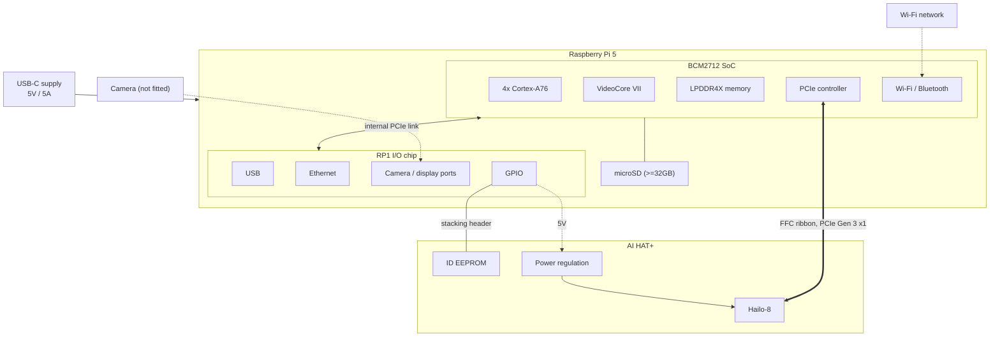
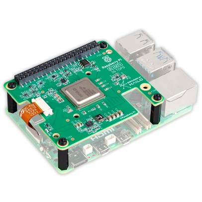

# Raspberry Pi 5 + AI HAT+ (Hailo-8)

Notes on the Raspberry Pi 5 and AI HAT+ (26 TOPS, Hailo-8) setup: how the hardware fits together, how I booted it, and how I checked that the Hailo was working. 

Hailo doesn't publish the low-level internals of the Hailo-8, so the chip is described here only as far as their documentation goes.

## Contents

1. [Hardware overview](#1-hardware-overview)
2. [Raspberry Pi 5](#2-raspberry-pi-5)
3. [PCIe link](#4-pcie-link)
4. [Hailo-8](#5-hailo-8)
5. [Software stack](#6-software-stack)
6. [Boot and OS setup](#8-boot-and-os-setup)
7. [Installing the Hailo software](#9-installing-the-hailo-software)
8. [Checking the Hailo](#10-checking-the-hailo)
9. [Still to test](#11-still-to-test)
10. [Troubleshooting](#12-troubleshooting)

---

## 1. Hardware overview

The Pi 5 runs the operating system and the application. The Hailo-8 sits on the AI HAT+ and does one job, running a compiled neural network. Frames go in over PCIe and results come back the same way.



Two things join the Pi and the HAT. The FFC ribbon carries the PCIe lane, so all inference data and device control go over it. The stacking header on the GPIO pins carries the HAT's identification and power. 

## 2. Raspberry Pi 5


| Block | Detail |
|---|---|
| CPU | BCM2712, four Arm Cortex-A76 cores, up to 2.4 GHz |
| GPU | VideoCore VII |
| Memory | 8 GB LPDDR4X, shared between CPU and GPU |
| External PCIe | One lane, officially Gen 2, Gen 3 available |
| I/O | RP1 chip: USB, Ethernet, camera/display ports, GPIO |
| Wireless | Wi-Fi and Bluetooth module on the SoC |

The RP1 chip is a separate part, connected to the SoC over its own internal PCIe link. The AI HAT+ uses the external connector, so USB and Ethernet traffic doesn't share a lane with the Hailo. It does still compete for CPU time and memory bandwidth.

Most of the work around the neural network happens on the CPU: decoding video, resizing, colour conversion, non-maximum suppression, and drawing boxes. 


## 4. PCIe link

The BCM2712 is the root complex and the Hailo-8 is the only device on the external lane.

| Link | Per-lane rate | Usable, one direction |
|---|---|---|
| Gen 2 x1 | 5 GT/s | about 0.5 GB/s |
| Gen 3 x1 (this setup) | 8 GT/s | about 1 GB/s |
| Gen 3 x4 (Hailo-8 M.2 module maximum) | 8 GT/s | about 4 GB/s |


## 5. Hailo-8


Hailo quotes 26 TOPS (INT8) and about 2.5 W typical for the Hailo-8. It uses what they call a structure-defined dataflow architecture. The Dataflow Compiler takes the network graph and maps its layers onto compute, memory and control resources on the chip, with data flowing between them along paths set up for that network. The memory is on-chip, so the accelerator needs no external DRAM.

This has a few practical consequences:

- A HEF file is the compiled result for one network on one chip family. It is a hardware configuration as well as weights, which is why `hailo8` and `hailo8l` HEFs are not interchangeable.
- Models run in INT8, so accuracy needs to be checked against the original float model after quantisation.
- Layers the compiler can't map have to be rewritten or run on the CPU.
- The chip does inference only. The Pi still needs its own memory for the OS, video decode, and application code.

Compiling a model happens on an x86 Linux machine with the Hailo Dataflow Compiler. The path is ONNX or TFLite, parse to a HAR file, optimise and quantise using calibration images, then compile to a HEF. I used a precompiled YOLOv8n HEF at `/usr/local/hailo/resources/models/hailo8/yolov8n.hef`, so I didn't run that flow myself.

26 TOPS is a peak figure and no real network uses the whole chip. `hailortcli benchmark` on the HEF gives the number that matters for a given model.

## 6. Software stack

| Layer | Component | What it does | How to check it |
|---|---|---|---|
| Hardware | Hailo-8, PCIe link | Runs the network | `lspci` |
| Firmware | Device firmware | Runs on the Hailo-8, loaded by the driver | `hailortcli fw-control identify` |
| Kernel | `hailo_pci` driver | Binds to the PCIe device, handles DMA, creates `/dev/hailo0` | `ls /dev/hailo0`, `dmesg` |
| Runtime | HailoRT, `hailortcli` | Loads HEFs, manages streams and buffers | `hailortcli scan`, `hailortcli --version` |
| Bindings | `hailo_platform` | Python API over HailoRT | `from hailo_platform import HEF` |
| Framework | Hailo Apps, TAPPAS | Input handling, pipelines, post-processing | Run an example app |
| Application | My detection script | The actual use case | Output images, FPS |

The driver, firmware and HailoRT versions have to be compatible. A kernel update that isn't matched by a driver update is a common reason for `/dev/hailo0` disappearing.


## 7. Boot and OS setup

I flashed Raspberry Pi OS 64-bit with Raspberry Pi Imager and set the hostname, user, Wi-Fi and SSH in the imager so the board could run headless. After booting I connected over SSH:

```bash
ssh ken@raspberrypi.local
```

Architecture and kernel:

```bash
uname -m     # aarch64
uname -r     # 6.8.0-1064-raspi
cat /etc/os-release
```

```text
PRETTY_NAME="Debian GNU/Linux 13 (trixie)"
NAME="Debian GNU/Linux"
VERSION_ID="13"
VERSION="13 (trixie)"
VERSION_CODENAME=trixie
DEBIAN_VERSION_FULL=13.7
ID=debian
HOME_URL="https://www.debian.org/"
SUPPORT_URL="https://www.debian.org/support"
BUG_REPORT_URL="https://bugs.debian.org/"
```

Then I updated the OS and the bootloader:

```bash
sudo apt update && sudo apt full-upgrade -y
sudo rpi-eeprom-update -a
sudo reboot
```

After the reboot I checked that the HAT showed up on the PCIe bus:

```bash
lspci | grep -i hailo
```

```text
0000:01:00.0 Co-processor: Hailo Technologies Ltd. Hailo-8 AI Processor (rev 01)
```


## 8. Installing the Hailo software

This installs the PCIe driver and firmware, HailoRT with `hailortcli`, and the Python bindings:

```bash
sudo apt install hailo-all
sudo reboot
```


## 9. Checking the Hailo

I worked up the stack from the hardware, and stopped at the first thing that failed.

| # | What it checks | Command | Expected | Result |
|---|---|---|---|---|
| 1 | Ribbon and PCIe device | `lspci \| grep -i hailo` | Hailo device listed | `0000:01:00.0 Co-processor: Hailo Technologies Ltd. Hailo-8 AI Processor (rev 01)` |
| 2 | Link speed | `sudo lspci -vv \| grep -A20 -i hailo` | `LnkSta` 8GT/s, x1 | `LnkCap: 8 GT/s, x4; LnkSta: 5 GT/s, x1` |
| 3 | Kernel driver | `ls /dev/hailo0`, `dmesg \| grep -i hailo` | Node exists, no errors | `/dev/hailo0 exists; driver: hailo (hailo_pci)` |
| 4 | Firmware | `hailortcli fw-control identify` | Architecture HAILO8 | Hailo-8, firmware 4.23.0 |
| 5 | Runtime | `hailortcli scan`, `hailortcli --version` | Device found | `Hailo Devices: [-] Device: 0001:01:00.0`,`HailoRT-CLI version 4.23.0` |
| 6 | Python bindings | `python -c "from hailo_platform import HEF"` | No error | Import worked |

```bash
$ hailortcli fw-control identify
Executing on device: 0001:01:00.0
Identifying board
Control Protocol Version: 2
Firmware Version: 4.23.0 (release,app,extended context switch buffer)
Logger Version: 0
Board Name: Hailo-8
Device Architecture: HAILO8
```

```bash
$ sudo lspci -vv | grep -A20 -i hailo
LnkCap and LnkSta lines indicating
0001:01:00.0 Co-processor: Hailo Technologies Ltd. Hailo-8 AI Processor (rev 01)
                LnkCap: Port #0, Speed 8GT/s, Width x4, ASPM L0s L1, Exit Latency L0s <1us, L1 <2us
                LnkSta: Speed 5GT/s (downgraded), Width x1 (downgraded)
                        TrErr- Train- SlotClk+ DLActive- BWMgmt- ABWMgmt-
--
        Kernel driver in use: hailo
        Kernel modules: hailo_pci
```

`LnkCap shows the maximum PCIe link capability advertised by the Hailo-8: PCIe Gen 3 x4 (8 GT/s).`
`LnkSta shows the PCIe link speed and width actually negotiated between the Hailo-8 and Raspberry Pi 5: PCIe Gen 2 x1 (5 GT/s)`


## 10. Troubleshooting

| Symptom | Layer | Likely cause and fix |
|---|---|---|
| Nothing in `lspci` | Hardware | Reseat the FFC ribbon (orientation, latches), check the HAT and header seating, use the official power supply, run `rpi-eeprom-update -a` |
| Dropouts or hangs | Hardware | Power, heat, or the ribbon. As a last resort force Gen 2 with `dtparam=pciex1_gen=2` in `/boot/firmware/config.txt` |
| `lspci` fine but no `/dev/hailo0` | Kernel | Driver not loaded. Check `dmesg`, try `sudo modprobe hailo_pci`, reinstall `hailo-all` |
| Firmware errors in `dmesg` | Kernel | Driver and firmware mismatch. Reinstall the matching packages and reboot |
| Stopped working after `apt upgrade` | Kernel | Kernel updated without a matching driver. Reinstall and reboot |
| `hailortcli fw-control identify` fails | Runtime | Check `hailortcli --version`, reinstall `hailo-all`, reboot |
| `import hailo_platform` fails | Bindings | Wrong Python environment. Activate the venv that has the bindings |

Problems I actually hit: 
1. SSH access was inconsistent, sometimes requiring that I wait for long or reflash the SD card, which resulted in lost configurations and work. **Solution**: Check network connectivity and SSH service before reflashing. Use `Test-NetConnection raspberrypi.local -Port 22` to verify SSH connectivity. Back up configurations regularly. 

2. Reflashing caused SSH host key verification errors. **Solution**: Remove the outdated key using `bash ssh-keygen -R raspberrypi.local`, verify the new fingerprint, and reconnect..


## 15. References

- Hailo-8 product page: <https://hailo.ai/hailo-8>
- Hailo-8 family overview: <https://www.newark.com/new-products/development-boards-evaluation-tools/hailo-8-ai-processor-family>
- CNX Software on the Hailo-8 architecture: <https://www.cnx-software.com/2020/10/07/learn-more-about-hailo-8-ai-accelerator-and-understanding-ai-benchmarks/>
- Electronic Design on the Hailo-8 M.2 and mPCIe modules: <https://www.electronicdesign.com/industrial-automation/article/21145019/inference-engine-squeezes-onto-m2-and-mini-pcie-modules>
- Raspberry Pi AI HAT+ documentation: <https://www.raspberrypi.com/documentation/accessories/ai-hat-plus.html>
- Raspberry Pi 5 documentation: <https://www.raspberrypi.com/documentation/computers/raspberry-pi.html>
- Hailo Developer Zone: <https://hailo.ai/developer-zone/>