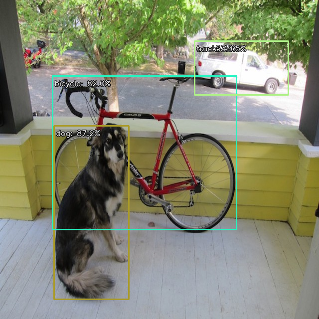

# YOLOv8 Object Detection on Raspberry Pi 5 with Hailo-8

## About the Project

This project involved deploying YOLOv8n on a Raspberry Pi 5 equipped with a Hailo-8 AI accelerator.

The goal was to run object detection locally on the Raspberry Pi using the hailo-8 accelerator. I used the Hailo Apps framework and a precompiled YOLOv8n model in HEF format.

All the setup, configuration and testing on the Raspberry Pi were done remotely through SSH.

I started by running object detection on sample images and successfully obtained images with bounding boxes around detected objects. I then explored using my Windows laptop's webcam as a remote video source, sending the video to the Raspberry Pi over Wi-Fi. Although I was able to establish the video stream and retrieve frames on the Pi, getting the complete live detection pipeline working remained a challenge.

## 1. Setting Up the Hailo Environment

I first installed and configured the Hailo software stack on the Raspberry Pi. This included HailoRT, the PCIe driver and Hailo Apps.

To check that the accelerator was detected, I ran:

```bash
hailortcli fw-control identify
```

The command successfully identified the device as a Hailo-8 running firmware version 4.23.0.

I also created and activated a Python virtual environment for working with Hailo Apps:

```bash
cd ~/Downloads/hailo-apps

source venv_hailo_apps/bin/activate
```

I checked that the Hailo Python API was available:

```python
from hailo_platform import HEF
```

The import worked successfully.

## 2. Loading the YOLOv8n Model

I downloaded the compiled YOLOv8n model in Hailo Executable Format (HEF) and stored it at:

```text
/usr/local/hailo/resources/models/hailo8/yolov8n.hef
```

Rather than building the entire inference pipeline from scratch, I used the object detection example provided in the Hailo Apps repository.

This provided the basic functionality for loading the model, processing images and handling detection results.

## 3. Object Detection Using Sample Images

My first objective was to get object detection working before attempting live video processing.

Because I don't have an rpi camera yet, I used a sample image as the input.

I ran the object detection application from the terminal over SSH:

```bash
python hailo_apps/python/standalone_apps/object_detection/object_detection.py \
  -n /usr/local/hailo/resources/models/hailo8/yolov8n.hef \
  -i /path/to/sample_image.jpg
```

The application successfully processed the image and produced output images with bounding boxes around detected objects.

This confirmed that the model could perform object detection using the Hailo-8 accelerator.

### Detection Results

The following images show some of the outputs obtained from the sample image tests.




## 4. Experimenting with Live Webcam Streaming

After getting image-based detection working, I wanted to see if I could use my laptop's webcam as a remote camera for the Raspberry Pi.

The idea was to capture video on the laptop, send it over Wi-Fi and let the Raspberry Pi process it using the Hailo-8.

### Setting Up the Webcam Server

I used OpenCV to capture frames from the laptop webcam and Flask to make the video available over HTTP.

I installed the required packages on Windows:

```bash
py -m pip install opencv-python flask
```

I then created a Python script called `webcam_server.py`:

```python
import cv2
from flask import Flask, Response

app = Flask(__name__)
camera = cv2.VideoCapture(0)

if not camera.isOpened():
    raise RuntimeError("Could not open laptop webcam")


def generate_frames():
    while True:
        success, frame = camera.read()

        if not success:
            break

        success, buffer = cv2.imencode(".jpg", frame)

        if not success:
            continue

        yield (
            b"--frame\r\n"
            b"Content-Type: image/jpeg\r\n\r\n"
            + buffer.tobytes()
            + b"\r\n"
        )


@app.route("/video")
def video():
    return Response(
        generate_frames(),
        mimetype="multipart/x-mixed-replace; boundary=frame"
    )


if __name__ == "__main__":
    app.run(host="0.0.0.0", port=5000, threaded=True)
```

I started the server with:

```bash
py webcam_server.py
```

The video stream was available at:

```text
http://192.168.10.212:5000/video
```

This was the laptop's local IP address during testing.

### Testing the Stream on the Raspberry Pi

With both devices connected to the same Wi-Fi network, I checked whether the Raspberry Pi could reach the laptop's webcam server.

```bash
curl -I http://192.168.10.212:5000/video
```

The server returned an HTTP 200 response.

I also used OpenCV on the Raspberry Pi to open the stream and retrieve a frame. The test returned:

```text
Image shape: (720, 1280, 3)
Data type: uint8
Pixel at top-left: [0 0 0]
```

This confirmed that the Raspberry Pi could receive and decode video frames from the laptop webcam.

### Connecting the Stream to Hailo Apps

The next step was to pass the webcam URL directly to the Hailo object detection application.

My first attempt failed because the input resolver in Hailo Apps did not recognise HTTP stream URLs as valid inputs. However, another part of the application already supported HTTP and RTSP streams.

I traced the issue to `core.py`, where the input source was checked before being passed to the stream-processing code.

I modified the input resolver to accept HTTP, HTTPS and RTSP URLs:

```python
if input_arg in CAMERA_KEYWORDS or input_arg.startswith("/dev/video") or input_arg.isdigit():
    return input_arg

if input_arg.startswith(("http://", "https://", "rtsp://")):
    return input_arg

path_candidate = Path(input_arg)
```

After this change, the application recognised the webcam URL as a stream input.

I launched the application using:

```bash
HAILO_MONITOR=1 python hailo_apps/python/standalone_apps/object_detection/object_detection.py \
  -n /usr/local/hailo/resources/models/hailo8/yolov8n.hef \
  -i http://192.168.10.212:5000/video \
  --no-display
```

The application reported:

```text
INFO | common.camera_utils | Using stream input:
http://192.168.10.212:5000/video
```

I also ran `hailortcli monitor` in a second SSH session. It displayed YOLOv8n entries and host-to-device (H2D) and device-to-host (D2H) transfers.

However, the live video experiment did not produce a reliable end-to-end detection and visualisation workflow. The stream could be accessed and frames could be decoded, but further work is needed to establish reliable live inference and retrieve the detection results.

## 5. Challenges I Encountered

### No Camera Connected to the Raspberry Pi

The Hailo Apps example initially tried to use the Raspberry Pi camera, which was not available.

I worked around this by using a sample image for the initial detection tests. I later experimented with using the laptop webcam as a remote video source.

### HTTP Stream Not Accepted by Hailo Apps

Although OpenCV could access the webcam stream, the Hailo application initially rejected the URL.

I traced this to the input resolver in `core.py` and modified it to accept HTTP, HTTPS and RTSP URLs.

### Running Without a Graphical Display

Since I was working entirely through SSH, the application could not open its normal display window.

I encountered the following Qt error:

```text
qt.qpa.xcb: could not connect to display
```

I used the `--no-display` option to run the application without attempting to open a graphical window.

### Live Video Processing

Getting the webcam stream into OpenCV was successful, but completing the connection between the video source, inference pipeline and detection output proved more challenging.

This is still an area I intend to investigate further.

### Temperature During Inference

The Raspberry Pi became noticeably hot during sustained execution. This made me consider the importance of cooling and thermal monitoring when running continuous AI workloads on the device.

## 6. Results

| Task | Status |
|---|---|
| Hailo-8 detection by Raspberry Pi | Successful |
| HailoRT and Python API setup | Successful |
| YOLOv8n HEF model loading | Successful |
| Object detection using sample images | Successful |
| Generating images with bounding boxes | Successful |
| Remote webcam server using Flask and OpenCV | Successful |
| Accessing webcam stream from Raspberry Pi | Successful |
| Decoding video frames using OpenCV | Successful |
| Modifying Hailo Apps to accept HTTP stream URLs | Successful |
| Observing YOLOv8n activity using Hailo Monitor | Successful |
| Reliable live video detection | Still in progress |

## 7. Next Steps

There are a few things I would like to work on next:

- Get the live webcam stream working reliably with the Hailo inference pipeline.
- Understand how the Hailo application handles detection post-processing.
- Display bounding boxes, object labels and confidence scores on live video.
- Save annotated images and detection results.
- Measure inference FPS and latency.
- Monitor CPU temperature and Hailo utilisation during continuous inference.
- Investigate the effects of video resolution and frame rate on performance.
